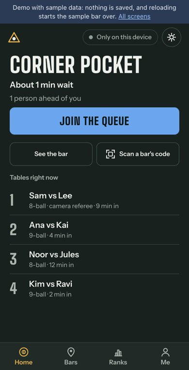

# Loopool demo

**Open it: https://nickkklian.github.io/loopool-demo/**

Loopool is a fair queue for pool tables and a camera referee for every shot. Players scan the QR code on the bar TV, join the queue from their phone and get called when a table is free; staff run the tables from a tablet; the TV shows the live game.

This demo runs entirely in your browser on a made-up sample bar: no server, nothing is saved, and reloading a screen starts it over. The screens: player app, joining from the bar's QR code, bar app and bar TV. The AI referee, emails and profile auto-fill need the real server and are not part of the demo.

